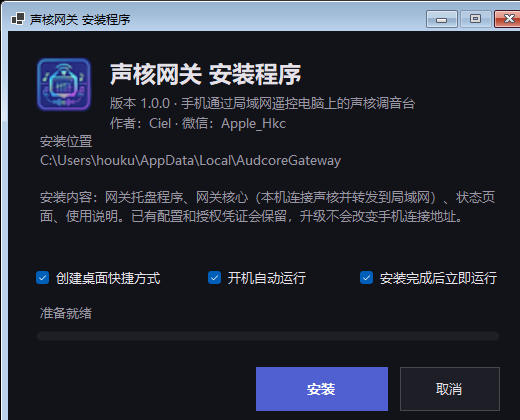
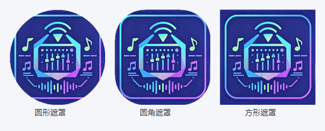

# 声核遥控 · Soundcore Remote

[](https://github.com/CielHou/soundcore-Remote/actions/workflows/ci.yml)
[](LICENSE)
[-3DDC84?logo=android&logoColor=white)]()
[]()
[]()

用手机遥控电脑上的「声核」机架。

声核只允许**电脑本机**连接它的 JSON WebSocket API（协议 v1），局域网直接连会被 403 拒绝。
本项目由两部分组成：

- **手机 App**（Kotlin / Android）：连接、实时同步通道列表、单通道静音、A/B 轨道一键互切、扫码连接、运行日志。
- **电脑网关**（Node.js 单文件核心 + WinForms 托盘 + Windows 安装程序）：在电脑本机连接声核，再把通道数据与控制请求通过局域网转发给手机。

```text
┌────────────┐   ws://127.0.0.1:38533    ┌──────────────┐   ws://192.168.x.x:18533   ┌────────────┐
│    声核     │ ◀──────────────────────▶ │  电脑网关     │ ◀────────────────────────▶ │  手机 App   │
│  （本机）   │        JSON WS v1        │ 18533 / 18534 │        局域网 WebSocket     │   遥控      │
└────────────┘                          └──────────────┘                            └────────────┘
```

## 截图

| Windows 安装程序 | 应用图标（自适应） |
| --- | --- |
|  |  |

## 功能

- **实时同步**：连接后自动订阅声核通道，声核里的改动实时推送到手机。
- **点击行即静音**：点通道整行或右侧开关，等价于开关该通道 `mute`（1.8.0 起不再使用独奏）。
- **A/B 轨道互切**：长按通道指定 A 轨 / B 轨，点底部 A / B 大按钮一键互切，其余通道不动。
- **编辑显示**：通道页右上角「编辑显示」可勾选哪些通道在手机上显示（只影响手机端，不改声核）。
- **扫码连接**：手机扫网关窗口展示的二维码，自动保存地址并重连，无需手输一长串 token 地址。
- **网关窗口二维码**：托盘控制面板按需展示，手机连上后不自动收起。
- **只列物理网卡**：手机连接地址仅在使用以太网 / Wi-Fi 的网卡中选择，自动排除 VMware、Hyper-V、WSL、Docker、VPN 等虚拟网卡。
- **凭证本地加密**：手机端 token 保存在 `EncryptedSharedPreferences`；运行日志自动脱敏 token，约 1 MB 循环写入。
- **日间 / 夜间主题**跟随系统。

## 下载

编译好的安装包发布在 [Releases](../../releases/latest)：

| 文件 | 说明 |
| --- | --- |
| `audcore-remote-<版本>-debug.apk` | 手机端，Android 8.0+；debug 签名，仅供自用与测试（本地构建产物名为 `声核遥控-debug.apk`） |
| `audcore-gateway-setup-<版本>.exe` | 电脑端网关，双击安装，默认不需要管理员权限（本地构建产物名为 `安装包\声核网关安装程序.exe`） |

> 仓库只放源码，安装包走 Releases（避免仓库体积膨胀）。Release 附件用 ASCII 命名，避免浏览器/命令行下载时中文名乱码。

## 快速开始

### 1. 电脑端：装网关

1. 打开声核，确认它在监听 `127.0.0.1:38533`。
2. 双击 `声核网关安装程序.exe` → 点「安装」。默认装到 `%LOCALAPPDATA%\AudcoreGateway`，不需要管理员权限。
3. 安装完成后托盘出现「声核网关」，双击可打开控制面板；首次运行 `声核连接` 会显示「未连接」，点「打开状态页面」按提示授权一次即可。

### 2. 手机端：连网关

1. 安装 APK，打开 App，允许通知权限。
2. 点「连接」→「扫码连接」，扫电脑上网关窗口的二维码（点「展示二维码」）。也可以手动填入状态页里给出的完整地址。
3. 连上后即可控制通道。

手动地址形如：

```text
ws://192.168.1.20:18533/api/v1?token=<手机令牌>
```

## 仓库结构

```text
.
├── app/                     # Android 手机端（Kotlin + Material 3）
│   └── src/main/java/cn/utae/audcore/remote/
│       ├── net/             # AudcoreClient：直连声核 / 经网关，OkHttp WebSocket
│       ├── service/         # ConnectionService：前台服务维持连接
│       ├── ui/              # 连接、通道、设置、日志四个页面 + ViewModel
│       ├── scan/            # CameraX + ML Kit 二维码扫描
│       ├── prefs/           # EncryptedSharedPreferences 配置
│       └── log/             # RuntimeLog：脱敏、1 MB 循环
├── gateway/                 # 电脑端网关
│   ├── src/                 # Node 核心：声核连接、手机 WebSocket、状态页、令牌
│   ├── public/              # 状态页（HTML/CSS/JS）
│   ├── desktop/GatewayTray/ # WinForms 托盘 + 控制面板（含二维码、日志窗口）
│   ├── desktop/GatewaySetup/# Windows 安装程序（单文件、自解压载荷）
│   ├── build/               # 构建脚本：SEA 打包、托盘发布、安装包打包、图标生成
│   ├── test/                # node:test 单元测试
│   └── scripts/             # 手动冒烟脚本
├── 电脑桥接/                 # netsh 端口转发方案（旧版直连声核的备选路径）
├── docs/images/             # README 截图
└── CHANGELOG.md             # 版本历史
```

## 从源码构建

### 手机 App

需要 JDK 17 与 Android SDK Platform 35（用 Android Studio 打开工程亦可）。

```powershell
.\gradlew.bat :app:assembleDebug
# 产物：app\build\outputs\apk\debug\app-debug.apk
```

单元测试：

```powershell
.\gradlew.bat :app:testDebugUnitTest
```

### 网关（开发调试）

需要 Node.js 20+。

```powershell
cd gateway
npm install
npm start
# 状态页：http://127.0.0.1:18534/
```

测试：

```powershell
cd gateway
npm test
```

### 网关发布包（Windows + .NET 8 SDK）

```powershell
# 1) 打包核心与托盘，输出到 %LOCALAPPDATA%\AudcoreGateway
pwsh -File gateway\build\build.ps1

# 2) 打成单文件安装包，输出到 安装包\声核网关安装程序.exe
pwsh -File gateway\build\build-setup.ps1
```

构建脚本会：esbuild 打包 Node 核心 → 注入 Node 运行时生成 `gateway-core.exe`（SEA 单文件）→ `dotnet publish` 托盘 → 组装发布目录 → 压缩载荷并生成安装程序。

## 配置与安全

- 网关默认监听手机口 `18533`、状态页 `18534`，声核地址 `ws://127.0.0.1:38533/api/v1`，见 `gateway/gateway.config.example.json`。
- 首次运行会在 `gateway/.state/` 生成两个令牌：
  - `client-token.txt`：手机连接令牌（至少 8 个字符，可自行修改），**会随手机地址一起可见**；
  - `audcore-token.txt`：声核授权凭证，只留在电脑上，不会下发给手机。
- 状态页默认只监听本机；手机侧只接受带正确 token 的连接。
- `.state/`、`gateway.config.json`、运行日志均已在 `.gitignore` 中排除，**提交代码前不要把它们加进仓库**；文档示例里的 token 一律写成 `<手机令牌>`。

## 常见问题

**手机连不上 / 握手 403？**
说明手机在直接连声核 `38533`。声核只接受本机连接，请改成网关地址（`18533` + `?token=...`）。

**网关窗口没有可选的地址？**
说明没检测到物理网卡（只有虚拟网卡）。确认已连上 Wi-Fi 或插网线；VMware / Hyper-V / WSL / Docker / VPN 网卡会被排除。

**安装程序提示需要管理员权限？**
只有当**旧版网关正以管理员身份运行**、普通权限无法覆盖它的文件时才会申请一次 UAC。管理员安装完成后托盘会切回当前用户启动，之后升级不再需要管理员。

**扫码后仍提示地址无效？**
二维码内容是完整 `ws://.../api/v1?token=...`；手工输入请确保带 `?token=`。

## 协议要点

- 首条消息发 `POST /connections`；首次授权返回 `202`，用户在声核点允许后收到 `authorized` 事件。
- 网关模式下先 `AUTH /gateway/authorize`，成功后复用电脑端已建立的声核授权。
- 订阅 `channels` / `channel-updated` / `update` 等事件；控制走 `PATCH /channels/{id}`（`mute`、`gain_db`）。
- 断线后指数退避重连（1s 起，上限 15s）；`401/403` 视为来源限制，停止自动重连并提示。

## 许可证

[MIT](LICENSE) © 2026 Ciel

版本历史见 [CHANGELOG.md](CHANGELOG.md)。
